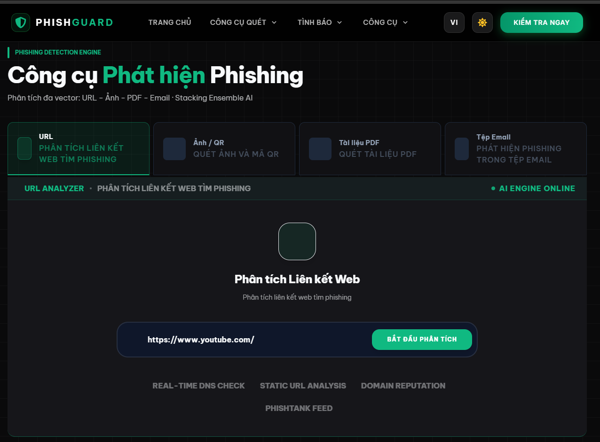
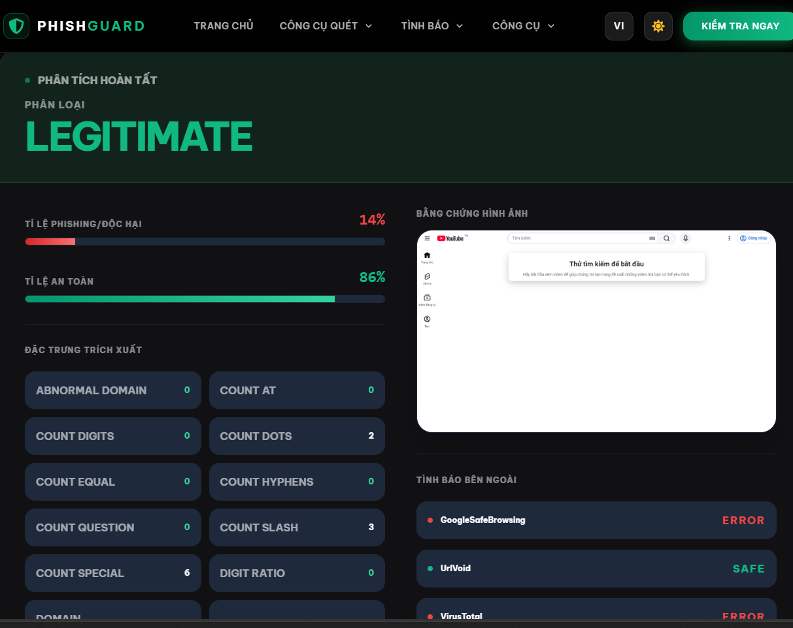
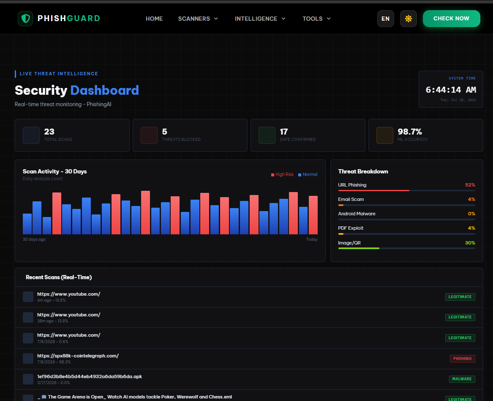
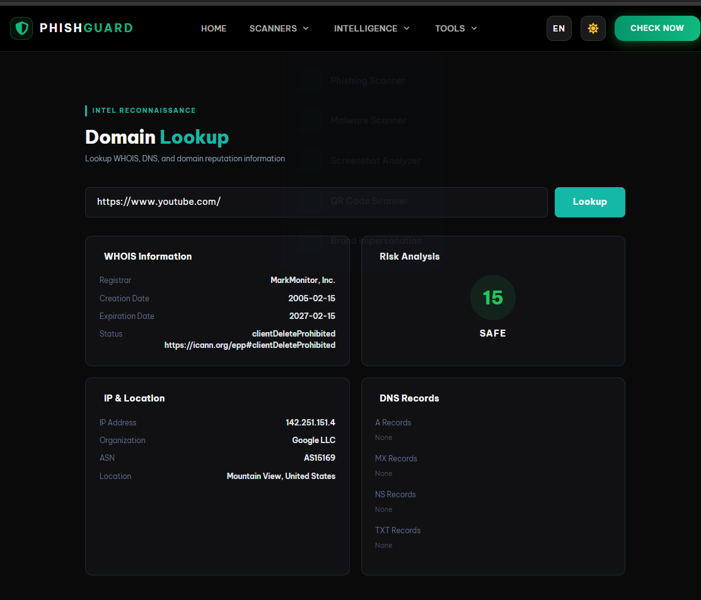
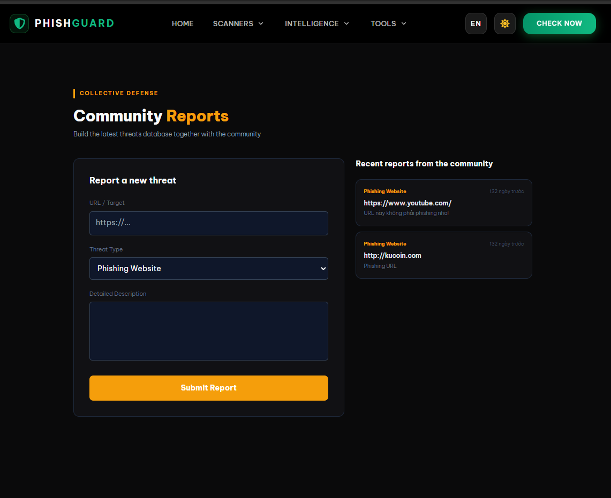
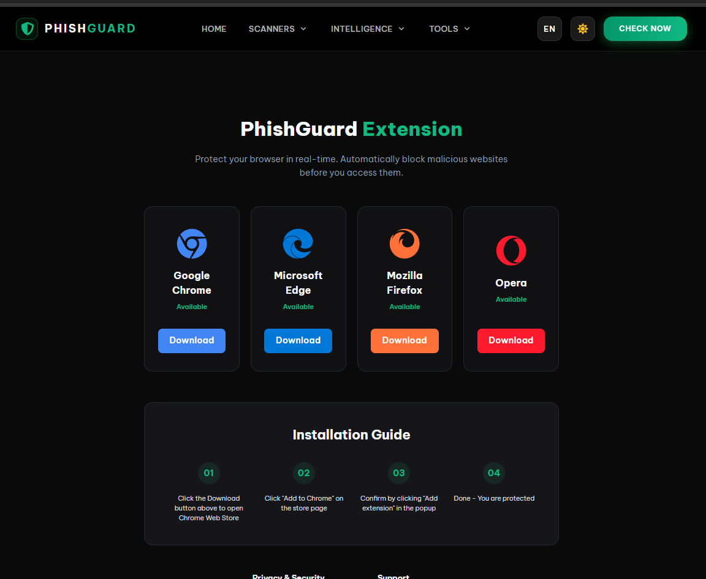

# PhishStack: Khung Đa Phương Thức Học Sâu Hợp Nhất Phát Hiện Trang Web Lừa Đảo Phishing Theo Thời Gian Thực

## 1. Tổng Quan Hệ Thống

PhishStack là một hệ thống phát hiện trang web lừa đảo (Phishing Detection System) dựa trên kiến trúc hợp nhất đa phương thức (Multimodal Ensemble Framework). Hệ thống kết hợp ba luồng phân tích độc lập:

1. Luồng phân tích Đặc trưng Chuỗi URL sử dụng Học máy Hợp nhất Stacking (Lexical URL Stacking Ensemble ML).
2. Luồng phân tích Hình ảnh Giao diện (Visual Appearance Analysis) sử dụng Mạng Nơ-ron Sâu EfficientNetV2-M.
3. Luồng phân tích Nội dung và Cấu trúc DOM (HTML & DOM Content Analysis).

Kết quả từ ba luồng được hợp nhất thông qua Động cơ Dũng hợp Động (Dynamic Weight Fusion Engine) kết hợp các quy tắc Đè lên Rủi ro Nguy hiểm (Hard Adversarial Overrides) và giải thích quyết định mô hình bằng SHAP (SHapley Additive exPlanations).

---

## 2. Kiến Trúc Hệ Thống (System Architecture)

Hệ thống bao gồm ba thành phần chính:

### Luồng 1: Phân tích Đặc trưng Chuỗi URL (Lexical URL Stacking Machine Learning)
Phân tích các dac trưng từ chuỗi URL bao gồm độ dài, số lượng ký tự đặc biệt, tấn công Homoglyph Unicode, độ hỗn loạn Shannon Entropy, tuổi miền (Domain Age), và việc sử dụng địa chỉ IP trực tiếp.
- Mô hình cơ sở (Base Models): LightGBM, XGBoost, CatBoost, Random Forest, Extra Trees, Gradient Boosting.
- Mô hình siêu cấp (Meta Model): Logistic Regression đóng vai trò Stacking Classifier.

### Luồng 2: Phân tích Hình ảnh Giao diện (Visual Deep Learning Inference)
Sử dụng công cụ Playwright tự động chụp ảnh màn hình trang web ở độ phân giải chuẩn 480x480x3 RGB.
- Mô hình mạng sâu: EfficientNetV2-M được huấn luyện tinh chỉnh (Fine-tuned).
- Nhiệm vụ: Nhận diện giao diện giả mạo các thương hiệu lớn như PayPal, Google, Ngân hàng, Microsoft.

### Luồng 3: Phân tích Nội dung va Cấu trúc DOM (Web Content & DOM Structure Analysis)
Phân tích nguồn mã HTML và cấu trúc DOM được trích xuất từ trang web:
- Kiểm tra địa chỉ Form Action nhằm phát hiện hành vi trích xuất dữ liệu trái phép (Data Exfiltration) sang tên miền khác.
- Phát hiện thẻ Iframe ẩn, kỹ thuật chặn chuột phải (Right-click restriction), ô nhập dữ liệu mật khẩu và email.
- Kiểm tra sự bất tương thích giữa Tiêu đề và Tên miền (Title-Domain Brand Mismatch).

### Động cơ Dũng hợp Đa phương thức (Multimodal Fusion Engine)
- Trọng số mặc định: URL Stacking (45%), Visual CNN (35%), Web Content (20%).
- Tự động điều chỉnh trọng số (Dynamic Re-normalization) khi trang web ngoại tuyến hoặc không chụp được ảnh màn hình.
- Kích hoạt cơ chế Hard Overrides trong các trường hợp tấn công nguy hiểm như Tấn công Unicode Homoglyph hoặc Giả mạo Thương hiệu.

---

## 3. Giao Diện Hệ Thống (System Screenshots)

### 3.1 Giao diện Trang chủ (Home Page)


### 3.2 Phân tích URL Lừa đảo (Phishing URL Scan Result)


### 3.3 Phân tích URL Hợp lệ (Legitimate URL Scan Result)


### 3.4 Bảng Điều Khiển Thống Kê & Tình Báo (Analytics Dashboard)


### 3.5 Tra Cứu Tên Miền & WHOIS (Domain Lookup Analysis)


### 3.6 Báo Cáo Cộng Đồng & Cảnh Báo Mối Đe Dọa (Community Threat Intelligence)


### 3.7 Tích Hợp Tiện Ích Mở Rộng Trình Duyệt (Browser Extension Integration)


---

## 4. Công Nghệ Sử Dụng (Tech Stack)

### Backend:
- Ngôn ngữ: Python 3.10+
- Web Framework: Flask, Flask-CORS
- Máy học & Học sâu: Scikit-learn, XGBoost, LightGBM, CatBoost, TensorFlow / Keras (EfficientNetV2-M), SHAP
- Thu thập dữ liệu web: Playwright, BeautifulSoup4, tldextract, python-whois

### Frontend:
- Framework: React 18, React Router v6
- Styling: Tailwind CSS, Vanilla CSS
- Hiệu ứng & Thành phần UI: Framer Motion, Lucide-React, Boxicons

---

## 5. Hướng Dẫn Cài Đặt Và Vận Hành

### 5.1 Yêu Cầu Hệ Thống
- Python phiên bản 3.10 trở lên
- Node.js phiên bản 18.x trở lên và npm
- Trình duyệt Chromium (phục vụ Playwright)

### 5.2 Cài Đặt Môi Trường Backend
```bash
# Tạo và kích hoạt môi trường ảo Python
python -m venv venv

# Trên hệ điều hành Windows:
venv\Scripts\activate

# Trên hệ điều hành Linux/Mac:
source venv/bin/activate

# Cài đặt các thư viện phụ thuộc
pip install -r requirements.txt

# Cài đặt trình duyệt Playwright phục vụ phân tích Visual
playwright install chromium
```

### 5.3 Đóng Gói Giao Diện Frontend
```bash
cd frontend
npm install
npm run build
cd ..
```

### 5.4 Khởi Chạy Server Trực Tiếp
Thực thi duy nhất một lệnh Python để khởi chạy đồng thời Webserver API backend và phục vụ gói tĩnh Frontend React:

```bash
python backend/app.py
```

Sau khi máy chủ khởi chạy, truy cập hệ thống tại địa chỉ: `http://localhost:5000`

### 5.5 Triển Khai Bằng Docker Container (Docker Build & Deployment)
Hệ thống hỗ trợ đóng gói đa tầng (Multi-stage Build) tự động đóng gói cả Frontend React và Backend Python kèm trình duyệt Playwright Chromium.

Cách 1: Sử dụng Docker Compose (Khuyên dùng)
```bash
# Xây dựng hình ảnh và khởi chạy Container
docker compose up --build -d

# Tắt Container
docker compose down
```

Cách 2: Sử dụng Docker CLI thủ công
```bash
# Xây dựng Docker Image
docker build -t phishguard-app:latest .

# Khởi chạy Docker Container trên cổng 5000
docker run -d -p 5000:5000 --name phishguard_system phishguard-app:latest
```

### 5.6 Xuất Và Chia Sẻ Docker Container Cho Người Khác

Trường hợp 1: Xuất tập tin ảnh Docker (.tar) để gửi trực tiếp cho người khác
```bash
# Xuất Docker Image ra tập tin phishguard_app.tar
docker save -o phishguard_app.tar phishguard-app:latest

# Người nhận nhập tập tin phishguard_app.tar và chạy
docker load -i phishguard_app.tar
docker run -d -p 5000:5000 --name phishguard_system phishguard-app:latest
```

Trường hợp 2: Gửi mã nguồn kèm Dockerfile
Người nhận chỉ cần tải mã nguồn dự án và chạy duy nhất lệnh:
```bash
docker compose up --build
```

---

## 6. Danh Sách API Endpoints Chính

| Phương thức | Endpoint | Mô tả chi tiết |
| --- | --- | --- |
| POST | `/api/url/predict` | Phân tích URL bằng mô hình Đa phương thức (URL + Visual + Content) |
| POST | `/api/url/scan` | Quét URL đầy đủ và trả về kết quả phân tích giải thích SHAP cùng Ảnh chụp màn hình |
| POST | `/api/image/predict` | Phân tích ảnh màn hình độc lập bằng mạng EfficientNetV2-M |
| GET | `/api/history` | Lấy lịch sử các lần quét URL của hệ thống |
| POST | `/api/report` | Gửi báo cáo URL lừa đảo từ người dùng cộng đồng |

---